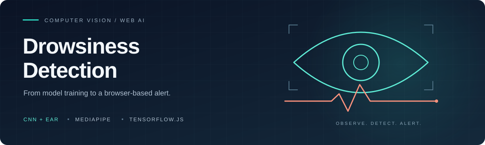
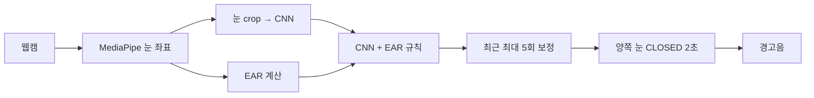

<p align="center">
  
</p>

<p align="center">
  <strong>운전자의 눈 상태를 분석하고, 지속적인 눈 감김에 반응하는 졸음 감지 프로젝트</strong><br>
  얼굴 이미지 분류 실험부터 CNN + EAR 브라우저 데모까지.
</p>

<p align="center">
  <a href="https://spacegaeguri.github.io/Drowsiness-Detection-System/browser-cnn-ear/"></a>
  <a href="https://colab.research.google.com/github/Spacegaeguri/Drowsiness-Detection-System/blob/main/Drowsiness_Detection_CNN.ipynb"></a>
  <a href="docs/README.md"></a>
</p>

<p align="center">
  <a href="https://www.tensorflow.org/"></a>
  <a href="https://keras.io/"></a>
  <a href="https://www.tensorflow.org/js"></a>
  <a href="https://ai.google.dev/edge/mediapipe/solutions/vision/face_landmarker"></a>
</p>

<p align="center">
  <a href="#바로-체험하기">바로 체험</a> ·
  <a href="#두-가지-구현">구현 비교</a> ·
  <a href="#웹-데모의-동작">동작 방식</a> ·
  <a href="#평가-결과">평가 결과</a> ·
  <a href="#저장소-안내">폴더 안내</a>
</p>

---

## 바로 체험하기

**[웹캠 졸음 감지 데모 열기 →](https://spacegaeguri.github.io/Drowsiness-Detection-System/browser-cnn-ear/)**

1. 페이지를 열고 모델 상태가 `READY`가 될 때까지 기다립니다.
2. `Start Camera`를 누르고 카메라 사용을 허용합니다.
3. 양쪽 눈이 닫힌 것으로 판단된 상태가 2초 이상 유지되면 `SLEEPING`과 경고음이 발생합니다.

웹 버전은 별도 Python 설치나 추론 서버 없이 브라우저에서 실행됩니다. 앱은 웹캠 영상을 저장하거나 서버로 전송하지 않습니다. 최초 모델·라이브러리 로딩에는 인터넷이 필요합니다.

> 카메라가 있는 기기에서 실행하고 소리 출력을 확인하세요. 이 프로젝트는 눈 감김 기반 프로토타입이며, 실차 안전성을 검증한 차량용 장치는 아닙니다.

## 두 가지 구현

이 저장소에는 입력과 목적이 다른 실험이 함께 있습니다. 모델 파일은 각 구현에서만 사용합니다.

| | 얼굴 이미지 분류 | CNN + EAR 웹 데모 |
| --- | --- | --- |
| 목적 | 얼굴 전체로 졸음/각성 분류 실험 | 실시간 눈 감김 분석과 경고 |
| 시작 위치 | [루트 노트북](Drowsiness_Detection_CNN.ipynb) | [browser-cnn-ear/](browser-cnn-ear/) |
| 입력 | 128×128 RGB 얼굴 | 64×64 RGB 눈 crop |
| 모델 | MobileNetV2 전이학습 | 작은 CNN + MediaPipe + EAR |
| 데이터 | Driver Drowsiness Dataset (DDD) | MRL Eye Dataset |
| 출력 | Drowsy / Non Drowsy | OPEN / CLOSED → 상태·경고 |
| 실행 | Colab에서 학습·이미지 업로드 추론 | GitHub Pages에서 웹캠 실시간 분석 |

별도 [Drowsiness-System/](Drowsiness-System/)에는 얼굴 입력을 사용하는 초기 일반 CNN 실험과 샘플 이미지가 보존되어 있습니다. 버전별 입력·전처리·실험 차이는 [구현 비교 문서](docs/PROJECT_VARIANTS.md)에 정리했습니다.

## 웹 데모의 동작



CNN은 눈 이미지의 외형을, EAR은 눈꺼풀 사이의 기하학적 거리를 분석합니다. 한 번의 결과로 경고하지 않고 최근 결과와 양쪽 눈의 지속 시간을 함께 확인합니다.

- **세 단계 결합:** 낮은 EAR, CNN·EAR 동시 판단, 높은 CNN 감긴 눈 점수를 순서대로 확인합니다.
- **기록 보정:** 각 눈의 최근 최대 5회 결과에서 CLOSED 비율이 60% 이상이면 CLOSED로 판단합니다.
- **지속 시간:** 두 눈의 보정 결과가 모두 CLOSED인 상태가 2초 이상 유지되면 경고합니다.
- **상태 초기화:** 눈이 열린 것으로 판정되거나 얼굴이 사라지면 타이머와 경고를 초기화합니다.

EAR이 높아도 CNN의 감긴 눈 점수가 0.85 이상이면 CLOSED가 될 수 있습니다. 정확한 조건과 경계값은 [구현 설명](browser-cnn-ear/docs/IMPLEMENTATION.md)을 참고하세요.

## 평가 결과

아래 수치는 **눈 이미지 CNN의 기존 Colab 검증 기록**입니다. 얼굴 모델이나 CNN+EAR 웹 전체 시스템의 성능 수치가 아닙니다.

| Accuracy | CLOSED Recall | OPEN Recall | 평가 이미지 |
| ---: | ---: | ---: | ---: |
| **91.53%** | **100%** | **83.52%** | **3,223장** |

검증 데이터가 EarlyStopping과 모델 선택에도 사용되었습니다. 독립 테스트 성능으로 해석할 수 없으며, 이번 저장소 정리에서 새로 측정한 값도 아닙니다. [혼동행렬·Precision·F1·한계 보기 →](browser-cnn-ear/docs/EVALUATION.md)

## 로컬 실행

웹 데모만 실행할 때는 학습용 라이브러리를 설치할 필요가 없습니다.

```bash
git clone https://github.com/Spacegaeguri/Drowsiness-Detection-System.git
cd Drowsiness-Detection-System
python3 -m http.server 8000 --bind 127.0.0.1
```

브라우저에서 `http://localhost:8000/browser-cnn-ear/`를 엽니다. 이 명령의 Python은 정적 파일 서버 역할만 합니다. 모델 재학습·평가·변환 방법은 [학습 안내](browser-cnn-ear/training/README.md)에 있습니다.

## 저장소 안내

```text
Drowsiness-Detection-System/
├── README.md                           프로젝트 소개와 데모 입구
├── Drowsiness_Detection_CNN.ipynb        얼굴 분류 · MobileNetV2 실험
├── Drowsiness-System/                   초기 얼굴 CNN 실험·샘플 이미지
├── browser-cnn-ear/                     독립 실행 가능한 웹 버전
│   ├── index.html · app.js             화면·카메라·눈 분석·경고
│   ├── model/                         TensorFlow.js 모델 구조·가중치
│   ├── best_eye_model.keras            원본 눈 상태 모델
│   ├── face_landmarker.task            MediaPipe 랜드마크 모델
│   ├── training/                      재학습·평가·모델 변환
│   ├── docs/                          구현·평가·발표 Q&A·검증 기록
│   └── reference/                     원본 설명 자료
├── docs/                              문서 목차·구현 비교·기존 기록
└── assets/                            README 시각 자료
```

| 읽고 싶은 내용 | 바로가기 |
| --- | --- |
| 실행·모델·문서 전체 길잡이 | [문서 목차](docs/README.md) |
| EAR 공식·임계값·2초 알람 | [구현 설명](browser-cnn-ear/docs/IMPLEMENTATION.md) |
| 수치와 평가의 한계 | [평가 문서](browser-cnn-ear/docs/EVALUATION.md) |
| CNN 선택 이유·예상 질문 | [발표 Q&A](browser-cnn-ear/docs/PRESENTATION_QA.md) |
| 설치·학습·평가·변환 | [학습 안내](browser-cnn-ear/training/README.md) |
| 실제 확인한 검증 범위 | [검증 기록](browser-cnn-ear/docs/VERIFICATION.md) |

## 다음 단계

- [ ] 인물 기준 독립 train / validation / test 구성
- [ ] 조명·안경·각도별 경고 성공률·오경보율·지연 측정
- [ ] 사용자별 EAR 보정과 영상 비율 영향 검증
- [ ] 하품·머리 자세·시선 등 추가 신호 검토

## 출처

웹 구현은 [gdpwemf/driver-drowsiness-detection](https://github.com/gdpwemf/driver-drowsiness-detection)의 코드·모델을 출처와 함께 가져와 하위 폴더 실행 경로를 적용했습니다. 학습 데이터와 라이브러리, 원본 커밋 및 수정 범위는 [SOURCES.md](browser-cnn-ear/SOURCES.md)에 기록했습니다.

기존 프로젝트 소개와 역할 설명은 [이전 README 기록](docs/archive/README-original.txt)에 보존했습니다.
